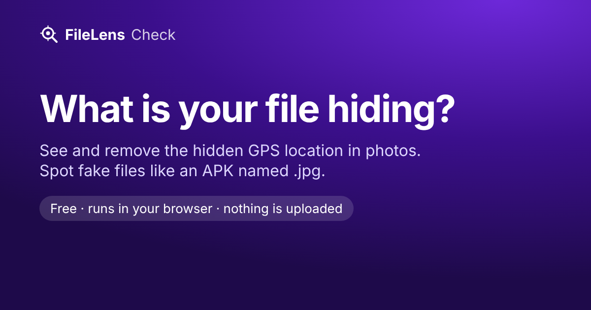

# FileLens Check

**What is your file hiding?** A free web page that shows the GPS location,
camera and date hidden in a photo and removes them, and tells you what a file
really is — for example an Android app (APK) disguised as `invitation.jpg`.

**→ https://andybuki.github.io/filelens-check/**

Available in 15 languages: English, العربية, Deutsch, Español, Français,
हिन्दी, Italiano, 日本語, 한국어, Polski, Português, Русский, Türkçe,
Українська, 简体中文.



- **Private by design:** everything runs in your browser. The page's security
  policy blocks every network request (`connect-src 'none'`), so files cannot
  be uploaded. No cookies, no analytics, no third-party scripts or fonts.
- **Lossless cleaning:** removes EXIF, XMP, IPTC and comments from JPEG, PNG
  and WebP without re-compressing the image. JPEG keeps only its orientation
  so photos are not shown sideways.
- **Fake-file check:** reads the file's first bytes to find its real type and
  warns about mismatched or double extensions (`bill.pdf.apk`), hidden
  right-to-left characters in names, scripts in PDFs and macros in Office
  files.

Not an antivirus: it does not compare files with virus databases.

It is the web companion of [FileLens](https://play.google.com/store/apps/details?id=app.com.filelens&referrer=utm_source%3Dgithub%26utm_medium%3Dreadme),
an Android file manager that does all of this automatically when you share or
open a file.

## Run it locally

A small Node script (no dependencies) builds one static page per language
into `_site/`:

```bash
node scripts/build.mjs                      # Node 22+
python3 -m http.server 8000 -d _site        # then open http://localhost:8000
```

## Tests

```bash
npm test                                   # byte-level logic + translation checks (Node 22+)
npm install --no-save playwright && npx playwright install chromium
npm run e2e                                # build, then a real browser; fails on any network request
python3 scripts/make_fixtures.py           # regenerate synthetic test files (Pillow)
```

## How it is built

| File | What it does |
|---|---|
| `src/core.js` | Real file type from magic bytes, risk findings (as codes), lossless JPEG/PNG/WebP metadata removal. No DOM, no network. |
| `app.js` | Page logic: reads the file locally, shows localized findings, offers the cleaned download. |
| `src/page.html` | Page template with `{{placeholders}}`. |
| `i18n/*.json` | All texts, one file per language. `en.json` is the reference. |
| `scripts/build.mjs` | Renders a page per language with `hreflang` links, writes `sitemap.xml`, and fails if a translation misses a key or a `{placeholder}`. |
| `vendor/exifr.umd.js` | [exifr](https://github.com/MikeKovarik/exifr) 7.1.3 (MIT), served from this site, used to read the metadata. |

Pushes to `main` build and deploy to GitHub Pages (`.github/workflows/pages.yml`);
only the built site is published, not tests or fixtures.

## Translations

Copy `i18n/en.json` to a new file, set `meta` (name, URL path, `hreflang`,
text direction, Google Play `hl`) and translate the values. Keep the
`{placeholders}` and the small HTML tags (`<strong>`, `<code>`, `<em>`).
`node scripts/build.mjs --check` tells you what is missing. Corrections by
native speakers are very welcome.

## License

[MIT](LICENSE). exifr is MIT-licensed, see `vendor/exifr.LICENSE`.
